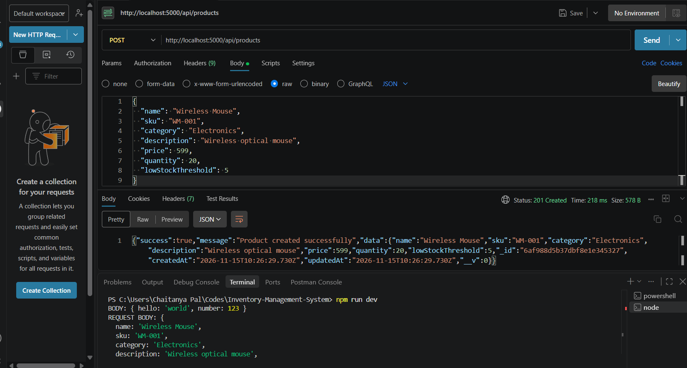
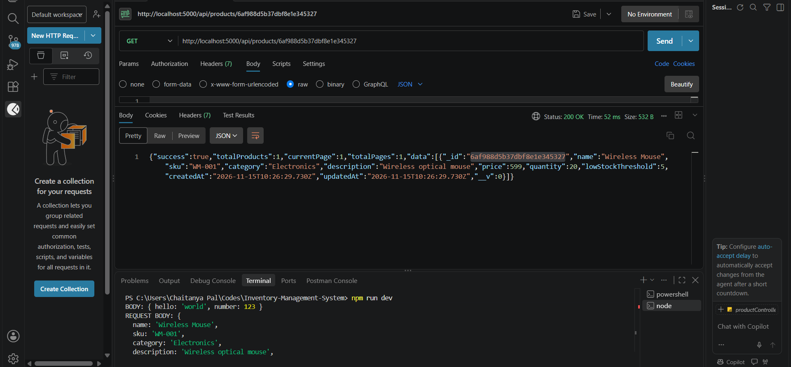
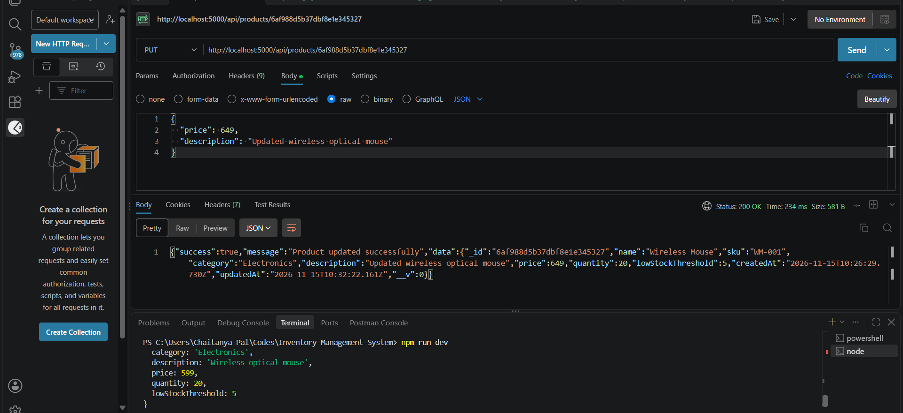
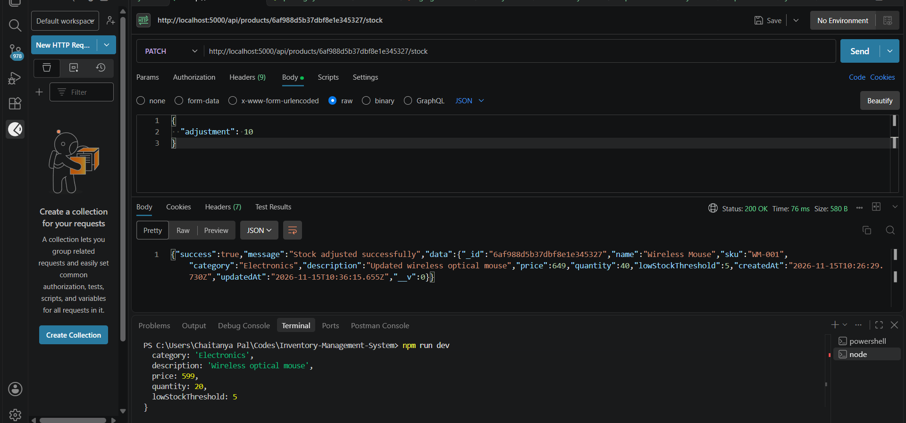
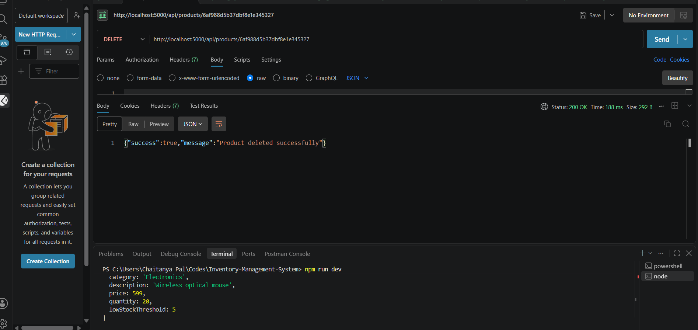
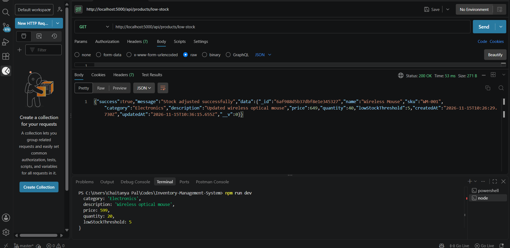
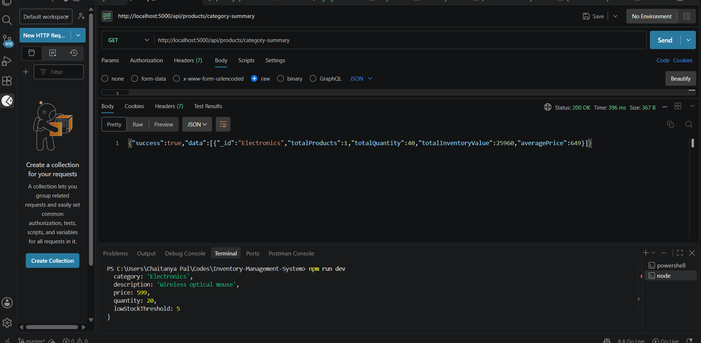

# Inventory Management System

## Project Overview

The Inventory Management System is a backend REST API developed using Node.js, Express.js, MongoDB, and Mongoose.

It provides functionality to manage products, track stock levels, filter and sort inventory, and generate inventory reports.

## Technologies Used

- Node.js
- Express.js
- MongoDB Atlas
- Mongoose
- dotenv
- Postman

## Project Structure

```text
Inventory-Management-System/
│
├── config/
│   └── db.js
│
├── controllers/
│   └── productController.js
│
├── middleware/
│   └── errorMiddleware.js
│
├── models/
│   └── Product.js
│
├── routes/
│   └── productRoutes.js
│
├── .env
├── .gitignore
├── package.json
├── package-lock.json
├── server.js
└── README.md
```

## Installation and Setup

1. Clone the repository:

```bash
git clone YOUR_GITHUB_REPOSITORY_URL
```

2. Navigate into the project folder:

```bash
cd Inventory-Management-System
```

3. Install dependencies:

```bash
npm install
```

4. Create a `.env` file in the root directory:

```env
PORT=5000


5. Start the development server:

```bash
npm run dev
```

The server runs at:

`http://localhost:5000`

## API Endpoints

Base URL: `http://localhost:5000/api/products`

| Method | Endpoint | Description |
|---|---|---|
| POST | `/` | Create a product |
| GET | `/` | Get all products |
| GET | `/:id` | Get product by ID |
| PUT | `/:id` | Update product |
| PATCH | `/:id/stock` | Adjust product stock |
| DELETE | `/:id` | Delete product |
| GET | `/low-stock` | Get low-stock products |
| GET | `/category-summary` | Get category-wise summary |

## Product Example

Example JSON request body:

```json
{
  "name": "Wireless Mouse",
  "sku": "WM-001",
  "category": "Electronics",
  "description": "Wireless optical mouse",
  "price": 599,
  "quantity": 20,
  "lowStockThreshold": 5
}
```

## Filtering, Sorting and Pagination

The GET all products endpoint supports:

- Filtering by product name and category
- Filtering by minimum and maximum price
- Sorting by name, price, quantity, and creation date
- Ascending and descending order
- Pagination using page and limit

Example:

`GET /api/products?category=Electronics&sortBy=price&order=asc&page=1&limit=5`

## Stock Management

The stock adjustment endpoint accepts a positive or negative whole-number adjustment.

Example:

```json
{
  "adjustment": 10
}
```

The system prevents stock quantity from becoming negative.

## Reports

### Low-Stock Report

Returns products whose quantity is less than or equal to their low-stock threshold.

### Category-wise Summary

Uses MongoDB aggregation to calculate:

- Total products per category
- Total quantity per category
- Total inventory value per category
- Average product price per category

## Testing

All eight API endpoints were tested using Postman.

### Postman Screenshots

Add your Screenshots below:

1. Create Product — `POST`

2. Get All Products — `GET`

3. Get Product by ID — `GET`

4. Update Product — `PUT`

5. Adjust Stock — `PATCH`

6. Delete Product — `DELETE`

7. Low-Stock Report — `GET`

8. Category-wise Summary — `GET
`


## Author

Name: Chaitanya Pal

Course: Web-Dev III

Project: Assignment 3 — Inventory and Data Management System
